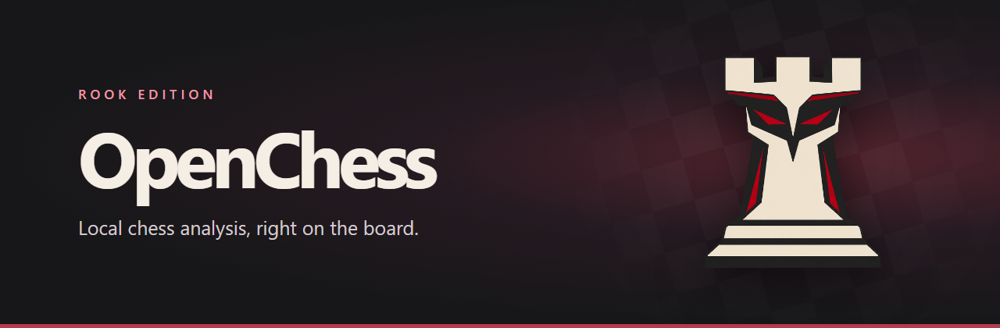
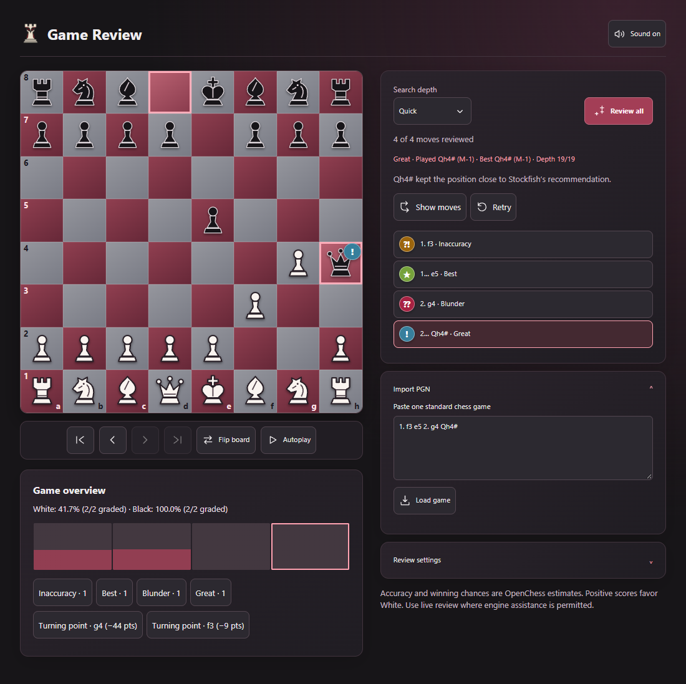
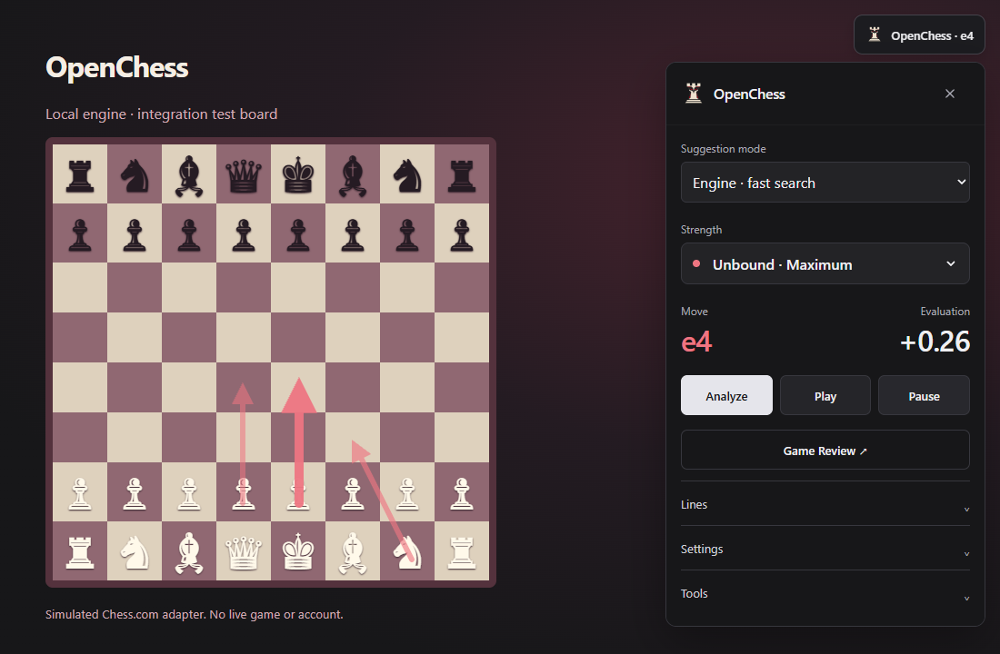
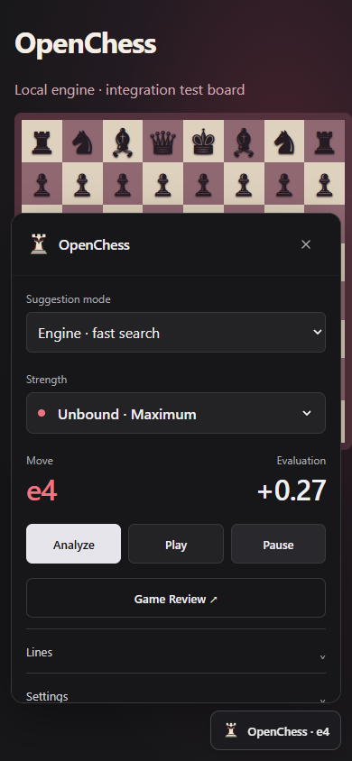
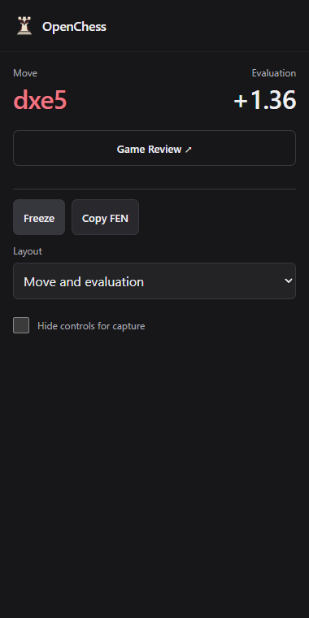

# OpenChess v1.5 · Rook Edition



**Free, open-source chess game review and local Stockfish analysis for Chess.com and Lichess.** Review a PGN, explore positions, or follow a practice board with color-coded move arrows. Analysis runs on your device and requires no account or subscription.

[Install](#install) · [Game Review](#game-review) · [Board analysis](#board-analysis) · [Streamer window](#streamer-window)

## Game Review



1. Click **Game Review** from OpenChess. Follow a practice board or paste a finished game under **Import PGN**.
2. Choose **Quick**, **Standard**, or **Deep**, then select **Review all**. OpenChess shows progress and reveals the completed analysis when Stockfish finishes.
3. Step through the game with **Next**, **Autoplay**, or the clickable winning-chance graph, move grades, and turning points.

Each reviewed move shows what you played, Stockfish’s recommendation, the evaluations, and search depth. The board marks the played square with its grade badge. **Show moves** replays the engine’s variation. **Retry** lets you explore legal alternatives from the original position.

The review also includes per-side accuracy estimates, coach notes, optional hints, adjustable autoplay, board flipping, optional move and capture sounds, and reduced-motion support. Grades and accuracy are OpenChess estimates and can change with the search budget. Import a PGN if the practice panel missed any moves.

## Board analysis

<table>
<tr><th>Desktop overlay</th><th>Mobile layout</th></tr>
<tr>
<td></td>
<td></td>
</tr>
</table>

- **Engine, Neural, and Human modes.** Pick fast Stockfish search, the full Stockfish neural network, or practical move ranking based on chess heuristics.
- **Up to five move arrows.** Choose 1, 3, or 5 suggestions. Arrow colors follow the strength preset.
- **12 strength presets.** Start around 300, 500, 700, or 1000 with approximate beginner styles, or choose a Stockfish Elo target up to 3000 or unrestricted strength.
- **Six personalities.** Balanced, Attacker, Positional, Defensive, Opportunist, and Gambiteer. The styles rank legal engine candidates differently.
- **Practice tools.** Play a suggestion, configure optional auto-play on compatible Chess.com boards, paste a FEN, or export analysis. Use engine assistance where permitted.
- **Lichess analysis.** Follow standard analysis boards and compatible studies that expose the position’s FEN. Lichess support is read-only.

## Streamer window



Open **Tools → Separate window** for a mirrored view. Choose full analysis, move and evaluation, or move only. Freeze a position, resume live updates, copy the FEN, or hide controls for capture.

Previews show the running extension on a simulated board.

## Install

Get the source from the [v1.5 release](https://github.com/NerdBlud/OpenChess/releases/tag/v1.5.0). If a Chromium build is attached, extract it and choose its folder under **Load unpacked** in Chrome or Edge developer mode.

To build from source, clone this repository and run these commands with Node.js 22 or later.

```bash
npm ci
npm run build
```

| Browser | Build folder | How to load |
| --- | --- | --- |
| Chrome or Edge | `dist/chrome` | Enable **Developer mode** and select **Load unpacked**. |
| Firefox | `dist/firefox` | Open `about:debugging#/runtime/this-firefox`, select **Load Temporary Add-on**, and choose `manifest.json`. |

Permanent installation on standard Firefox requires an XPI signed by Mozilla. The Firefox build is unsigned. Firefox runtime and physical mobile devices remain untested.

## Development and licenses

Run `npm test` for unit tests. Install the test browser with `npx playwright install chromium`, then run `npm run check` for the build and browser integration suite.

OpenChess is independent of Chess.com and Lichess. [User guide](docs/guide.md) · [GPL-3.0-or-later](LICENSE) · [Stockfish source and third-party licenses](THIRD_PARTY.md)
